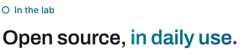
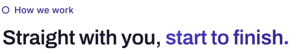
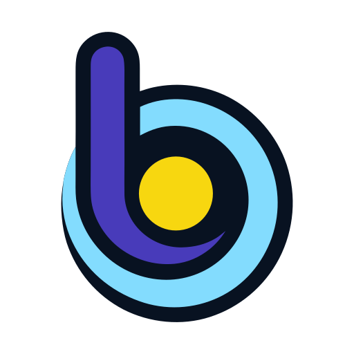

<div align="center">

<a href="https://bezacore.com"></a>

<a href="https://bezacore.com"></a>
<a href="mailto:joseph@bezacore.com"></a>
<a href="https://bsky.app/profile/bezacore.com"></a>
<a href="https://x.com/BezaCoreLabs"></a>
<a href="https://www.linkedin.com/company/bezacore-labs/"></a>

</div>

<br />

The people doing the most meaningful work often have the least technology, or tools built for someone ten times their size. **BezaCore Labs is a software studio that builds for them:** software small enough for the smallest team to pick up, and built to grow their own capacity rather than their dependence on us.

We build our own products, take on fixed-scope work for mission-driven organizations, and share the tools we make for ourselves as open source.

<br />

<picture>
  <source media="(prefers-color-scheme: dark)" srcset="https://raw.githubusercontent.com/BezaCore-Labs/.github/main/profile/assets/heading_lab_dark.svg" />
  
</picture>

What we built to run the studio on, shared in case it helps you too. Both are early: in daily use here, and new to everyone else.

<table>
<tr>
<td width="50%" valign="top">

<a href="https://github.com/BezaCore-Labs/never4ga"></a>

### [Never4gA](https://github.com/BezaCore-Labs/never4ga)

**Memory for you and every AI agent you work with.** Your notes, decisions and project history stay as plain Markdown on your machine, and each agent session starts with exactly the part it needs. Finding that part takes lookups, not a model, so it costs no tokens and gives the same answer every time.

<a href="https://pypi.org/project/never4ga/"></a>


```bash
uv tool install never4ga
```

</td>
<td width="50%" valign="top">

<a href="https://github.com/BezaCore-Labs/never4ga-obsidian"></a>

### [Never4gA Companion](https://github.com/BezaCore-Labs/never4ga-obsidian)

**Never4gA, beside the note you're reading in Obsidian.** The context pack and why each item is in it, search, health and open work. It never writes to your vault itself: every change goes through the Never4gA service, under the same rules as its command line.

<a href="https://github.com/BezaCore-Labs/never4ga-obsidian/releases/latest"></a>


Install it from the [latest release](https://github.com/BezaCore-Labs/never4ga-obsidian/releases/latest), or with BRAT: `BezaCore-Labs/never4ga-obsidian`.

</td>
</tr>
</table>

Using one of them, or want something like it for your organization? [Read the docs and tell us where they're wrong](https://github.com/BezaCore-Labs/never4ga/issues).

<br />

<picture>
  <source media="(prefers-color-scheme: dark)" srcset="https://raw.githubusercontent.com/BezaCore-Labs/.github/main/profile/assets/heading_next_dark.svg" />
  
</picture>

<table>
<tr>
<td width="180" align="center" valign="middle">
<picture>
  <source media="(prefers-color-scheme: dark)" srcset="https://raw.githubusercontent.com/BezaCore-Labs/.github/main/profile/assets/building_dark.svg" />
  
</picture>
</td>
<td valign="middle">

**Operations software for small, mission-driven teams**, who do purposeful work on tools made for someone else's size. It should make the job lighter, not heavier, and be small enough to pick up without help.

We'll name it when there's something you can use. Until then, [follow along at bezacore.com](https://bezacore.com/software/).

</td>
</tr>
</table>

<br />

<picture>
  <source media="(prefers-color-scheme: dark)" srcset="https://raw.githubusercontent.com/BezaCore-Labs/.github/main/profile/assets/heading_how_dark.svg" />
  
</picture>

<table>
<tr>
<td width="50%" valign="top">
<picture>
  <source media="(prefers-color-scheme: dark)" srcset="https://raw.githubusercontent.com/BezaCore-Labs/.github/main/profile/assets/icon_receipt-text_dark.svg" />
  
</picture>

**Fixed scope, plain prices.** Every piece of work has a fixed scope and a price you see before it starts.
</td>
<td width="50%" valign="top">
<picture>
  <source media="(prefers-color-scheme: dark)" srcset="https://raw.githubusercontent.com/BezaCore-Labs/.github/main/profile/assets/icon_key-round_dark.svg" />
  
</picture>

**Your capacity, not our dependence.** When we're done, you can run it, change it and explain it.
</td>
</tr>
<tr>
<td width="50%" valign="top">
<picture>
  <source media="(prefers-color-scheme: dark)" srcset="https://raw.githubusercontent.com/BezaCore-Labs/.github/main/profile/assets/icon_message-square-text_dark.svg" />
  
</picture>

**Straight with you.** Including what a tool doesn't do. If something free or off the shelf does the job, we'll say so.
</td>
<td width="50%" valign="top">
<picture>
  <source media="(prefers-color-scheme: dark)" srcset="https://raw.githubusercontent.com/BezaCore-Labs/.github/main/profile/assets/icon_circle-dot_dark.svg" />
  
</picture>

**One at a time.** We take on one engagement at a time, so the work we're doing gets our full attention.
</td>
</tr>
</table>

<br />

<picture>
  <source media="(prefers-color-scheme: dark)" srcset="https://raw.githubusercontent.com/BezaCore-Labs/.github/main/profile/assets/heading_work_dark.svg" />
  
</picture>

We take on fixed-scope work for mission-driven organizations: a diagnostic, a build, or training your team to run what they have. Tell us a little about your organization and what's slowing the work down, and we'll be straight with you about what we can do.

<p>
  <a href="mailto:joseph@bezacore.com"></a>
  <a href="https://bezacore.com/services/"></a>
  <a href="https://bezacore.com/services/cost-estimator/"></a>
</p>

<br />

<picture>
  <source media="(prefers-color-scheme: dark)" srcset="https://raw.githubusercontent.com/BezaCore-Labs/.github/main/profile/assets/heading_tools_dark.svg" />
  
</picture>

<p align="center">
  <br />
  
</p>

<br />

<div align="center">

<picture>
  <source media="(prefers-color-scheme: dark)" srcset="https://raw.githubusercontent.com/BezaCore-Labs/.github/main/profile/assets/bezacore_mark_on-dark.svg" />
  
</picture>

**BezaCore Labs** · Purposeful software for meaningful work

The studio is run by its founder, Joseph Soper. His own work is on his profile.

<a href="https://github.com/thejollydev"></a>

<sub>© 2026 BezaCore Labs LLC</sub>

</div>
